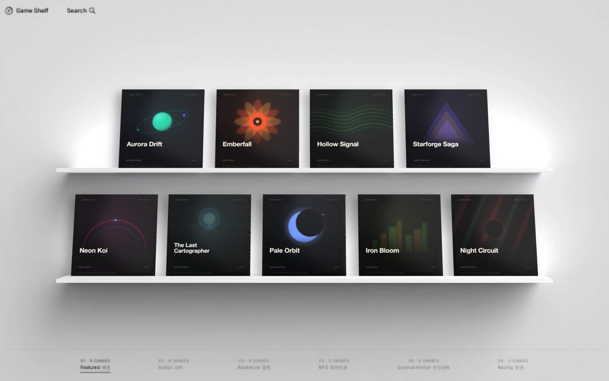
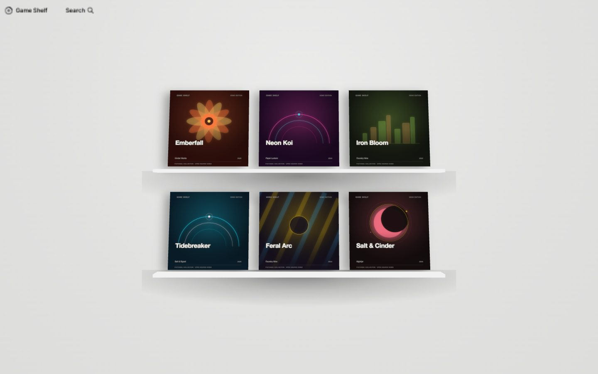

# Game Shelf UI

An open-source 3D game shelf for browsing a collection. Built with Next.js, React and Three.js.





## Live demo

[**Open the live demo →**](https://yaoyao2mm.github.io/open-shelf/)

The live version is deployed with GitHub Pages, so it does not depend on any private server or custom domain. Pushing to `main` runs [`.github/workflows/deploy-pages.yml`](.github/workflows/deploy-pages.yml). The screenshots above are static; the link opens the interactive 3D shelf.

This is a standalone front-end demo: no accounts, no database, no private paths, no deployment scripts. The collection, studios and cover art in the demo are fictional, so the project can be published and shared as-is.

## What it does

- A 3D shelf with nine featured covers, hover lift, a spring-driven cover flip and a detail view.
- Scroll out (or pick a category) to open the collection wall, laid out as a shelf rack.
- Category walls for Action, Adventure, RPG, Survival Horror and Racing.
- Search across the whole collection.
- A detail page for every entry.
- Responsive desktop and mobile layouts.
- Static export support for GitHub Pages, Netlify, Vercel or any static host.
- Demo artwork generated as SVG by a small script, so there are no binary image assets.

## Stack

- Next.js 16 (App Router)
- React 19
- Three.js
- TypeScript
- No UI framework, no CSS-in-JS, no backend

## Getting started

Requires Node.js 20 or newer.

```bash
npm install
npm run dev
```

Open <http://localhost:3000>.

Other scripts:

```bash
npm run typecheck   # TypeScript
npm run build       # production build
npm run art         # regenerate the demo cover art
```

## Make it yours

The collection lives in one file: [`src/data/games.json`](src/data/games.json). Each entry looks like this:

```json
{
  "id": "aurora-drift",
  "title": "Aurora Drift",
  "shortTitle": "Aurora Drift",
  "developer": "Northlight Studio",
  "year": "2025",
  "description": "A short line for the hover card.",
  "longDescription": "The longer text used by the detail page.",
  "categories": ["racing"],
  "featured": true,
  "palette": ["#07142b", "#31e1c4", "#8b7bff"],
  "motif": "orbit",
  "bgColor": "#07142b"
}
```

- `featured: true` puts a game on the front shelf. Nine entries are laid out on the two shelf rows; extra entries live on the collection wall.
- `categories` accepts `action`, `adventure`, `rpg`, `horror` and `racing`.
- `palette` is the three-colour palette used by the generated artwork.
- `motif` selects the artwork pattern. Available motifs: `orbit`, `bloom`, `wave`, `prism`, `arc`, `grid`, `eclipse`, `monolith`, `stripes`, `spiral`, `constellation`, `rings`.

After editing the data, run:

```bash
npm run art
```

The script writes square covers to `public/demo/covers/` and back covers to `public/demo/backs/`.

### Use your own artwork

Replace the generated SVGs with your own files. Keep the same ids and update the paths if you change the extension:

```ts
cover: asset(`/covers/${game.id}.webp`),
back: asset(`/backs/${game.id}.webp`),
```

The 3D scene and the `next/image` views use the same two files per game, so a square image around 1024×1024 is enough. Do not commit artwork you do not have the rights to redistribute.

## Static export

The app can be built as static files:

```bash
NEXT_STATIC_EXPORT=1 npm run build
```

The output is written to `out/`. To host it under a sub-path:

```bash
NEXT_STATIC_EXPORT=1 NEXT_PUBLIC_BASE_PATH=/game-shelf npm run build
```

`basePath` and `assetPrefix` are wired through `next.config.ts`, and every asset URL respects `NEXT_PUBLIC_BASE_PATH`.

## Project layout

```text
src/
  app/
    page.tsx                     # shelf page
    games/[id]/page.tsx          # detail page
    library.css                  # shelf UI
  components/library/
    GameShelf.tsx                # DOM shell, search, mobile, category index
    ShelfScene.ts                # Three.js scene
    games.ts                     # data loader and helpers
    walls.ts                     # category wall entries
    layoutWall.ts                # two-row wall layout
    layoutCollectionRack.ts      # collection rack layout
    icons.tsx
  data/games.json                # the collection
  types/library.ts
public/demo/                     # generated fictional artwork
scripts/generate-demo-art.mjs    # cover/back generator
```

The demo cover art is generated in SVG. The room shelf uses the baked model and plastic-wrap textures in `public/demo/` so the lighting and material match the original shelf design; provenance and reuse notes are in [`LICENSES/THIRD-PARTY.md`](LICENSES/THIRD-PARTY.md).

## Artwork and trademarks

All demo titles, studios, descriptions and cover art are fictional and were created for this project. Any real product names, logos or trademarks mentioned by users of this project remain the property of their respective owners. This repository does not include commercial game artwork.

The 3D shelf model and plastic-wrap textures are third-party visual references included for parity with the original design. Read [`LICENSES/THIRD-PARTY.md`](LICENSES/THIRD-PARTY.md) before redistributing or using the project commercially.

## License

The application code and generated fictional cover art are released under the [MIT license](LICENSE). The third-party shelf model, PBR textures and Inter font are covered by their own terms; see [`LICENSES/THIRD-PARTY.md`](LICENSES/THIRD-PARTY.md).
