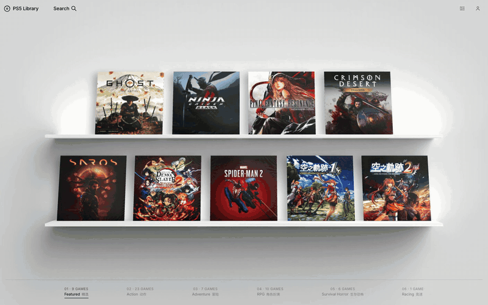

# Game Shelf

**把你真正拥有的游戏，放回一排书架上。**



大多数收藏最后都会变成一张表格：游戏名、存储大小、备份日期。它很有用，但不像房间里的那排书架。

Game Shelf 想把那种感觉放回屏幕上。第一眼看到的是你每天会看到的那层书架：几张自己挑出来的封面，站在一束温和的房间光里。鼠标移上去，盒子会轻轻抬起；打开它，能看到封底、工作室和年份。继续往外滚，书架会向后退，变成一整面更高的收藏墙，并按你熟悉的类型分开。

上面的动图录制自一个私人收藏版本。这个仓库里的公开演示数据是虚构的，所以可以直接分享，不用带上任何人的真实收藏。

## 它是什么感觉

- **先是一层书架，不是一张网格。** 九张精选游戏放在两块层板上，有房间光、塑封反光和带一点重量的翻面动画。
- **拉远，看见整个收藏。** 滚轮向后，精选书架变成整面收藏墙的底部，其余游戏填满上方的层板。
- **按类型逛。** 动作、冒险、角色扮演、生存恐怖、竞速，各有自己的墙面。
- **搜索整个收藏。** 按游戏名、工作室、年份或简介查找。
- **打开一款游戏。** 每个条目都有独立详情页，放着封面、开发商、发行年份和说明。
- **手机也能用。** 手机端变成一叠可以滑动切换的卡片，并保留独立的详情视图。

## 跑起来

需要 Node.js 20 或更高版本。

```bash
npm install
npm run dev
```

打开 <http://localhost:3000>。

```bash
npm run typecheck   # TypeScript 检查
npm run build       # 生产构建
npm run art         # 重新生成演示封面
```

没有账号、没有数据库、没有后端。整个收藏就是一份 JSON。

## 换成你自己的收藏

编辑 [`src/data/games.json`](src/data/games.json)。一个条目长这样：

```json
{
  "id": "aurora-drift",
  "title": "Aurora Drift",
  "shortTitle": "Aurora Drift",
  "developer": "Northlight Studio",
  "year": "2025",
  "description": "悬停卡片上的一句话简介。",
  "longDescription": "详情页使用的长简介。",
  "categories": ["racing"],
  "featured": true,
  "palette": ["#07142b", "#31e1c4", "#8b7bff"],
  "motif": "orbit",
  "bgColor": "#07142b"
}
```

- `featured: true` 会把游戏放上首页书架。前九个精选条目填满两块层板，其余条目放在拉远后的收藏墙上。
- `categories` 可选 `action`、`adventure`、`rpg`、`horror`、`racing`。
- `palette` 是生成封面时使用的三色配色。
- `motif` 是封面图案，可选 `orbit`、`bloom`、`wave`、`prism`、`arc`、`grid`、`eclipse`、`monolith`、`stripes`、`spiral`、`constellation`、`rings`。

改完数据后运行：

```bash
npm run art
```

封面会写到 `public/demo/covers/`，封底写到 `public/demo/backs/`。

### 使用自己的封面

用自己的方形图片替换生成的 SVG，必要时修改 `games.ts` 里的扩展名：

```ts
cover: asset(`/covers/${game.id}.webp`),
back: asset(`/backs/${game.id}.webp`),
```

3D 场景和页面视图共用同一对文件，所以每款游戏只需要一张约 1024×1024 的方形封面和一张封底。请不要公开你没有 redistribution 授权的商业游戏封面。

## 它是怎么做的

```text
src/
  app/
    page.tsx                     # 书架首页
    games/[id]/page.tsx          # 详情页
    library.css                  # 书架界面样式
  components/library/
    GameShelf.tsx                # DOM 外壳、搜索、手机布局、分类索引
    ShelfScene.ts                # Three.js 场景、相机、光照、收藏墙
    games.ts                     # 数据加载和辅助函数
    walls.ts                     # 分类墙条目
    layoutWall.ts                # 两排墙面布局
    layoutCollectionRack.ts      # 收藏层架布局
    icons.tsx
  data/games.json                # 收藏数据
  types/library.ts
public/demo/                     # 演示封面、书架模型和贴图
scripts/generate-demo-art.mjs    # 封面/封底生成脚本
```

书架是一个 Three.js 场景：烘焙好的房间模型、在书架和收藏墙之间缓动的相机、用 DOM 叠在场景上的封面和按钮，以及负责编辑风格排版的 CSS。数据层刻意做得很小，没有需要接的 API。

## 部署

可以导出成纯静态文件：

```bash
NEXT_STATIC_EXPORT=1 npm run build
```

产物在 `out/`。如果要部署在子路径下：

```bash
NEXT_STATIC_EXPORT=1 NEXT_PUBLIC_BASE_PATH=/game-shelf npm run build
```

仓库里还带了 GitHub Pages 工作流 [`.github/workflows/deploy-pages.yml`](.github/workflows/deploy-pages.yml)。推送到 `main` 就会自动构建并发布，不需要私人服务器或自定义域名。

## 素材与第三方资源

演示中的游戏名、工作室、简介和封面均为本项目虚构。真实产品名、Logo 或商标仍归各自权利人所有。本仓库不包含商业游戏封面。

书架模型、塑封贴图和 Inter 字体属于第三方视觉参考素材，是为了和原版设计保持一致而保留的。再分发或商业使用前请先阅读 [`LICENSES/THIRD-PARTY.md`](LICENSES/THIRD-PARTY.md)。

## 许可证

应用代码和生成的虚构封面使用 [MIT](LICENSE) 许可。第三方书架模型、PBR 贴图和 Inter 字体遵循各自的许可条款，详见 [`LICENSES/THIRD-PARTY.md`](LICENSES/THIRD-PARTY.md)。
